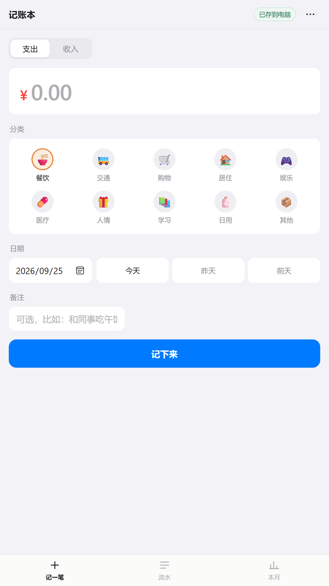
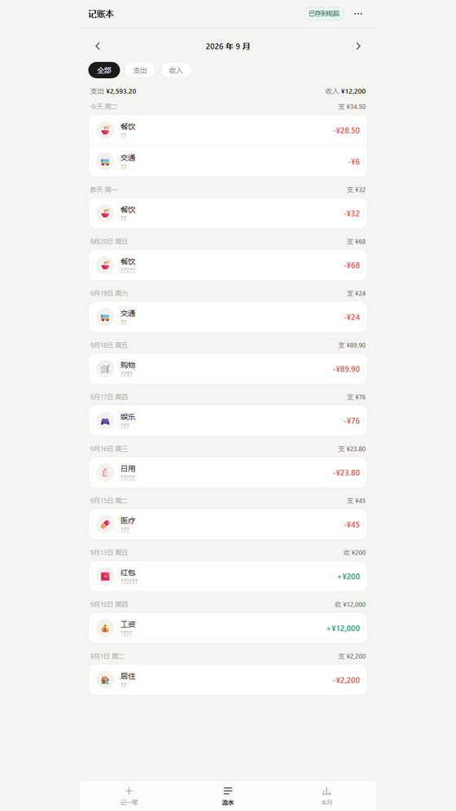
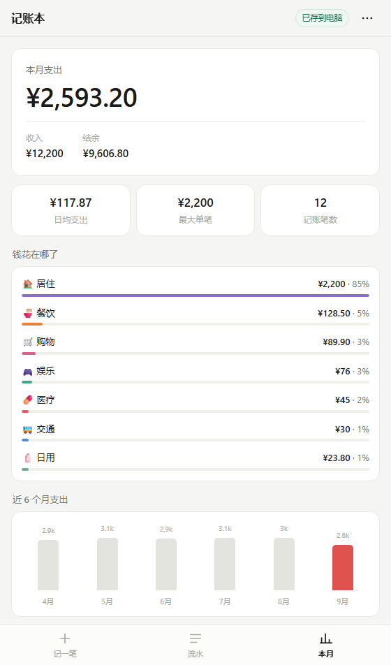

# 记账本

<p align="center">
  
  
  
</p>

<p align="center">
  <a href="LICENSE"></a>
  
  
  
</p>

一个只属于你自己的记账程序。

数据存在**你自己电脑上的一个 JSON 文件**里，不注册、不登录、不联网、不上传。
手机连同一个 WiFi 也能用，和电脑共享同一份账目。想看一眼自己的账目，
用记事本打开那个文件就行。

- **零依赖** —— 只用 Node 内置模块，不需要 `npm install`
- **数据在你自己手里** —— 没有人能远程看到、删掉或拿走你的账目
- **手机电脑同一份数据** —— 手机上记一笔，电脑上刷新就在

---

<a id="sec-quick"></a>

## 快速开始

给有基础的人，三步：

```bash
git clone https://github.com/BUR9ERR/expense-ledger.git
cd expense-ledger
node server.js
```

然后打开 <http://localhost:8765>。**Windows 用户直接双击 `启动记账本.bat` 更省事**，
它会自动找 Node、启动服务、打开浏览器。

| 项目 | 值 |
|---|---|
| 前提 | Node.js 18 或更高（**没有任何 npm 依赖**，装完 Node 就能跑） |
| 默认端口 | 8765，`PORT=9000 node server.js` 可改 |
| 数据文件 | `data/ledger.json`（普通 JSON，记事本可读） |
| 自动备份 | `data/backups/`，保留最近 30 份 |
| 手机访问 | `http://<电脑局域网IP>:8765`，同一 WiFi 下 |
| 不自动开浏览器 | `LEDGER_NO_BROWSER=1 node server.js` |

接口一共四个：

| 方法 | 路径 | 说明 |
|---|---|---|
| GET | `/api/db` | 取回完整账本和当前 `rev` |
| PUT | `/api/db` | 保存。body 为 `{ rev, data }`；`rev` 不匹配返回 **409** + 最新数据 |
| GET | `/api/info` | 端口、局域网地址、数据文件路径、备份目录 |
| POST | `/api/shutdown` | 让服务自己退出（网页端的「停止记账本服务」用的就是它） |

静态服务只放行根目录的 `index.html` 和 `assets/` 下的文件，其余一律 403。

**接着往下是保姆级指南**，完全没碰过命令行也能跟着做完；
有基础的话上面这些就够了，后面的[功能详解](#sec-features)和[原理](#sec-how)按需看。

---

## 目录

- [快速开始](#sec-quick)（有基础的人看这里就够了）
- [一、保姆级上手指南](#sec-guide)
- [二、功能详解](#sec-features)
- [三、出问题了怎么排查](#sec-trouble)
- [四、它是怎么工作的](#sec-how)
- [五、文件与技术细节](#sec-tech)
- [六、许可证、参与与免责](#sec-license)
- [版本历史](#sec-versions)

---

<a id="sec-guide"></a>

# 一、保姆级上手指南

这一节假设你**从没装过开发环境、没打开过命令行**。每一步都写了「你应该看到什么」，
对不上就翻到[第三节排查](#sec-trouble)。

全程大约 15 分钟，其中 10 分钟是等 Node.js 安装。

## 第 0 步 · 先确认这个程序适合你

**适合你，如果：**

- 你想要一个简单的记账工具，记完能一眼看到这个月花了多少
- 你希望数据完完全全在自己手里，不想上传到任何公司的服务器
- 你家里或办公室有一台电脑，平时是开着的（台式机、或者常插电的笔记本）
- 你主要在一台电脑 + 自己手机之间记账

**可能不适合你，如果：**

- 你希望手机上随时随地都能记（不需要电脑开着）→ 这个方案要求电脑开着
- 你想在手机流量下记账，或者在外面用 → 只能同一 WiFi
- 你需要在多台设备之间自动云同步 → 这个方案不做账号体系
- 你用的是 iPhone 且完全不想碰电脑 → 电脑那边还是得有个服务

> 说清楚这些不是劝退，是免得你装到一半才发现用不上。

## 第 1 步 · 把项目拿到自己电脑上

### 方式 A：下载压缩包（推荐给不熟悉命令行的）

1. 打开本项目页面，找到绿色的 **`< > Code`** 按钮，点开
2. 选 **Download ZIP**
3. 下载完成后，把压缩包**解压到一个固定的位置**，比如 `D:\记账本`
4. 解压后打开那个文件夹，应该能看到 `index.html`、`server.js`、`启动记账本.bat` 这些文件

> **位置建议**：不要放在「下载」文件夹里，也不要放在桌面。挑一个你不会随手删掉的地方。
> 因为这个文件夹里将来存着你的账目数据。

### 方式 B：用 git 克隆（适合已经装了 git 的）

```bash
git clone https://github.com/BUR9ERR/expense-ledger.git
```

文件夹在哪由你在哪执行这条命令决定。

## 第 2 步 · 安装 Node.js

这个程序需要 Node.js 才能跑（就是那个黑窗口里在后台干活的东西）。

### 2.1 先检查是不是已经装过了

**Windows**：按 `Win + R`，输入 `cmd` 回车，打开一个黑窗口。输入：

```
node -v
```

**macOS**：打开「终端」，输入同样的命令。

如果显示出 `v18.x.x` 或更高的版本号（比如 `v22.11.0`），**说明已经装好了，跳到第 3 步**。
如果显示「不是内部或外部命令」「command not found」之类的，继续往下。

### 2.2 下载安装

1. 打开 <https://nodejs.org>
2. 下载 **LTS** 版本（左边那个按钮，写着 LTS 的）
3. 双击下载的文件，一路点「下一步」到安装完成，**不需要改任何选项**

> **为什么是 LTS**：LTS 是长期支持版，最稳定。别选右边那个 Current。

### 2.3 验证装好了

**关掉刚才那个命令行窗口，重新开一个**（这一步很重要，不重开读不到新装的程序）。

再输入一次：

```
node -v
```

这次应该看到版本号了，例如：

```
v22.11.0
```

看到了就成功了。没看到就翻[第三节](#sec-trouble)。

## 第 3 步 · 启动

### Windows

**双击项目文件夹里的 `启动记账本.bat`。**

会弹出一个黑色的窗口（**这个窗口不要关，它就是服务本身**），里面打印类似：

```
  记账本已经启动
  ----------------------------------------------------------
  在这台电脑上打开：  http://localhost:8765
  在手机上打开：      http://192.168.1.5:8765
  ----------------------------------------------------------
  数据文件：D:\记账本\data\ledger.json
  ----------------------------------------------------------
  这个窗口关掉，服务就停了，手机也会跟着断。
```

同时浏览器会自动打开记账本页面。如果没自动打开，手动在浏览器地址栏输入
`http://localhost:8765` 也一样。

> `192.168.1.5` 只是示例，**你看到的会是别的数字**，那是这台电脑在局域网里的地址。

### macOS / Linux

没有对应的启动脚本，在终端里进入项目文件夹执行：

```bash
node server.js
```

### 如果窗口一闪就没了

说明启动失败了，通常是 Node 没找到。把项目文件夹里 `停止记账本.bat` 双击一次清理残留，
然后按[第三节](#sec-trouble)的「双击 bat 没反应」排查。

## 第 4 步 · 记第一笔

页面打开后停在**「记一笔」**页，从上到下依次是：

| 位置 | 做什么 |
|---|---|
| 最上面的「支出 / 收入」 | 决定记的是花钱还是进账，默认是支出 |
| 大号的金额框 | 输入金额，支持两位小数 |
| 「分类」九宫格 | **点一下**选中，选中的那个会有边框和底色 |
| 「日期」 | 默认今天。急了可以直接点「昨天」「前天」 |
| 「备注」 | 可以不填，最多 40 字 |
| 黑色大按钮 | 点「记下来」 |

记完一笔后，**金额和备注会清空，分类和日期会保留**——连续记同一类开销时不用重复选。

**电脑上还有三个快捷键**：

- 金额框里按 `回车` → 直接保存
- 备注框里按 `回车` → 直接保存
- 按 `Esc` → 关掉弹出的面板

## 第 5 步 · 在手机上用

手机和电脑看到的是**同一份数据**，所以手机上记一笔，电脑上刷新就能看到，不用导出导入。

1. **确认手机和电脑连的是同一个 WiFi。**
   （一个连 WiFi、另一个连手机热点，是不通的）
2. 在电脑的记账本页面点右上角 **`⋯`** → **数据管理** → 找到**「在手机上用」**区块
3. 点里面的**复制地址**按钮
4. 把这个地址发到手机上（微信发给自己就行），在手机上点开
5. **第一次连接时 Windows 可能弹防火墙提示**，一定要选**允许访问**，
   否则手机连不上。选错了就翻[第三节](#sec-trouble)
6. 在手机浏览器的菜单里选「**添加到主屏幕**」。之后就像普通 App 一样，一点就开

> 手机上如果一直转圈打不开，九成是这三个原因：不在同一 WiFi、防火墙被拒过、黑窗口关了。
> 具体见[第三节](#sec-trouble)。

## 第 6 步 · 日常怎么用

```
花完钱 → 手机点开主屏图标 → 输金额、点分类 → 记下来
```

想看这个月花了多少，切到「本月」页；想找某一笔，切到「流水」页。
两个页面的数据都是实时从电脑上的文件来的。

**只要手机和电脑不「同时」改，就不会有冲突。** 万一真的同时改了，
后保存的一方会自动把两边合并，你刚记的那笔不会丢（原理见[冲突处理](#sec-conflict)）。

## 第 7 步 · 备份（这一条别跳过）

数据在你的电脑上，好处是没人能拿走；代价是**没人为你兜底**，所以要自己留一手。

三层保护，按重要性排：

| 做法 | 怎么操作 | 防什么 |
|---|---|---|
| **换地方留底**（最重要） | `⋯ → 数据管理 → 导出备份文件`，存到网盘或另一块硬盘 | 电脑坏掉、硬盘损坏、误删整个文件夹 |
| 自动历史版本 | 不用管，程序每次保存前自动留档到 `data/backups/` | 记错了想退回前几天 |
| 数据文件本身 | `data/ledger.json`，随时可以复制走 | —— |

> **建议**：每个月点一次「导出备份文件」，把文件丢进网盘。一分钟的事。

## 第 8 步 · 关掉服务

三种方式，任选：

| 方式 | 用在什么时候 |
|---|---|
| 直接关掉那个黑色窗口 | 窗口就在眼前 |
| 双击 `停止记账本.bat` | 窗口被压在一堆窗口后面找不到 |
| 网页里 `⋯ → 数据管理 → 停止记账本服务` | 懒得离开浏览器，**手机上也能点** |

用第三种方式停掉后，页面会显示一个提示层。这时你去双击 `启动记账本.bat`，
**页面会自己恢复，不用手动刷新**。

面板里的选项用颜色区分操作性质，颜色是有含义的：

- **黄色文字**（停止记账本服务）= 会中断服务，但**不会丢数据**（账目都已经写进文件了）
- **红色文字**（清空所有数据）= **不可撤销**的破坏性操作

鼠标悬停在任意选项上会浮现对应色系的底色（电脑上才有悬停，手机不受影响）。
看到黄色不用担心，看到红色才要停下来想一下。

**关掉服务不会丢数据**，账目都已经写进文件了。想再用的时候重新双击 `启动记账本.bat`。

> `停止记账本.bat` 按「node 进程 + 命令行里含 server.js」匹配，只杀记账本这类进程，
> 找不到就提示你，不会瞎杀。注意：如果你同时在跑**别的也叫 server.js 的 Node 项目**，
> 它也会被一起停掉——这种场景请直接关那个项目的窗口。

## 第 9 步 · 不想用了怎么卸载

这个程序**没有安装过程**，所以也不需要「卸载」：

1. 按上面第 8 步把服务停掉
2. 想要数据就先把 `data/ledger.json` 复制走（或者用「导出备份文件」）
3. 直接把整个项目文件夹删掉

电脑上不会残留任何东西——不写注册表、不装服务、没有开机自启。
Node.js 如果别的程序还要用就留着，不需要的话到「控制面板 → 程序和功能」里卸掉它。

---

<a id="sec-features"></a>

# 二、功能详解

## 1. 记一笔（打开就是这一页）

最有用的一个页面，目标是把记一笔压缩到三次触碰。

| 项目 | 说明 |
|---|---|
| 支出 / 收入 | 顶部切换。切到收入后金额会变绿，所有收入分类自动切换出来 |
| 金额 | 支持小数，最多两位。手机上自动弹数字键盘 |
| 分类 | 点一下选中。**支出**有餐饮、交通、购物、居住、娱乐、医疗、人情、学习、日用、其他；**收入**有工资、奖金、兼职、投资、红包、其他 |
| 日期 | 默认今天，旁边有「今天 / 昨天 / 前天」一键切换；要更早的日期直接点日期框选 |
| 备注 | 可留空。最多 40 字 |

保存后金额和备注会自动清空，**分类和日期会保留**——连续记同一类开销时不用重复选。

**电脑上的快捷键**

- 金额框里按 `回车` → 直接保存
- 备注框里按 `回车` → 直接保存
- 按 `Esc` → 关闭弹出的面板

## 2. 流水

按月回看每一笔。

- **按月翻页**：标题两边有 `‹` `›`，点一下就换月份
- **直接选年月**：点中间那个「2026 年 9 月」，会弹出一张年月面板，12 个月一次看全；
  记过账的月份下面带个小圆点，点一下直接跳过去。面板里还能翻年份、一键「回到本月」。
  再点标题、点页面空白处或按 `Esc` 就收起来
- **按类型筛**：全部 / 支出 / 收入
- **按日分组**：每天一个卡片，日期用「今天」「昨天」或「9月18日 周五」表示
- **日小计**：每天的卡片头部显示当天支出和收入各多少
- **顶部合计**：当月支出总额、收入总额

**点任意一条就能改或删**：会载入这条数据到「记一笔」页，按钮变成「保存修改」，
下方多出一个「删除这笔」。不想改了，点右上角「取消编辑」。

**改完会自动回到刚才那条**：保存、取消或删除之后，页面回到「流水」并停在这笔账原来的位置
（刚改的那条会淡淡闪一下，一眼就能看到）。如果你把日期改到了别的月份，
它会自动翻到那个月，不会出现「改完就找不着了」。删除后就停在原来的滚动位置。

## 3. 本月

一眼看清这个月的状况。

- **本月支出**：大号数字，最醒目的位置
- **收入 / 结余**：结余 = 收入 − 支出
- **日均支出**：按已过天数平均；看历史月份时按整月天数算
- **最大单笔**：本月金额最大的一笔支出
- **记账笔数**：本月所有记录（含收入）的条数
- **钱花在哪了**：支出分类排行，每条带金额、占比和条形图，按金额从多到少排
- **近 6 个月支出**：柱状趋势图，当前月份用红色标出，一眼看出花销起伏

## 4. 数据管理（右上角「⋯」）

| 功能 | 用途 |
|---|---|
| **在手机上用** | 显示可用的手机地址，一键复制，不用自己找 IP |
| **重新加载** | 从电脑上的文件重新读一次最新数据。手机上记完账，电脑上点这个就同步了 |
| **导出备份文件** | 下载一个 `.json` 文件，用于异地留底或整机迁移 |
| **复制为文本** | 把账本复制成一段文字，微信发给另一台设备，粘进去就能导入 |
| **导入账本** | 选文件或粘贴文本，自动去重合并 |
| **导入微信 / 支付宝账单** | 选两家导出的账单文件（微信 xlsx、支付宝 csv 都直接读），按交易单号去重、按关键词词库自动猜分类（词库可自行扩充），导入前先给你看预览 |
| **停止记账本服务** | 关掉电脑上的服务。手机和浏览器都会断开，账目不受影响。标题用**黄色文字**以示提醒 |
| **清空所有数据** | 删掉全部账目。标题和说明都是**红色**。需要连续确认两次，无法撤销 |

## 5. 同步状态

右上角会显示一个小徽标：

- **已存到电脑**（绿色）—— 数据已经写进电脑上的文件，可以放心
- **保存中** —— 正在写入，通常一瞬间
- **未连上**（红色）—— 连不上服务，这次改动没存进去，检查服务是否还在运行

看不到这个徽标，说明现在是浏览器存储模式（详见[四、它是怎么工作的](#sec-how)）。

## 6. 数据迁移

- **留底**：数据管理 →「导出备份文件」，把文件存到网盘
- **迁移到新电脑**：把整个项目文件夹拷过去（**含 `data/` 目录**），双击 bat 即可
- **只有备份文件**：新电脑上打开记账本 →「导入账本」→ 选那个文件

## 7. 导入微信 / 支付宝账单

微信和支付宝都**不提供个人的消费数据接口**——开放平台那套只给商户，拿不到你自己的消费流水。
所以「自动同步」这件事本身做不到，能做到的是：**你把账单导出来，一次导进来。**

### 怎么导出

| | 操作路径 |
|---|---|
| 微信 | 我 → 服务 → 钱包 → **账单** → 右上角 `···` → **下载账单** → **用于个人对账** |
| 支付宝 | 我的 → **账单** → 右上角 `···` → **开具交易流水证明** → **用于个人对账** |

两边都填自己邮箱，选好时间范围（单次最长一年），**务必勾上「展示交易对方信息」和「展示商品说明信息」**
——这两列是自动猜分类的依据。收到的 zip 用邮件/服务消息里的密码解开，把里面的文件拿出来就行。

然后：`⋯ → 数据管理 → 导入微信 / 支付宝账单` → 选那个文件 → 看预览 → 确认导入。

### 格式

| 来源 | 文件 | 程序怎么读 |
|---|---|---|
| 微信 | `.xlsx`（Excel） | 直接读，不用转格式 |
| 支付宝 | `.csv` | 直接读，GBK 编码自动识别 |

微信给的是 Excel，程序里自带了一个精简的 xlsx 解析器（见下面「实现说明」），
所以**不需要**先用 Excel 另存成 CSV。

### 它会怎么处理

- **认来源**：自动分辨是微信还是支付宝的账单，两家的列名格式不一样，各按各的解析
- **认格式**：`.xlsx` 按 Excel 读，`.csv` 按文本读并自动识别 GBK / UTF-8
- **去重**：账目 id 直接用**交易单号 / 交易订单号**，所以**同一份账单导一百次也不会重复记账**
- **跳过非消费**：转账、理财、信用卡还款这类「不计收支」的，以及退款、未成功的，都会跳过并在预览里说明数量
- **猜分类**：按「交易对方 + 商品 / 商品说明」关键词猜（美团→餐饮、滴滴→交通、淘宝→购物、房租→居住……），
  说明栏会拼成「美团 · 美团外卖订单」这样，导入后可以逐条改。
  猜不出来时落到「其他」，不会乱猜；账单自带的「交易分类 / 交易类型」列只在关键词没命中时兜底，
  专门用来捞「转账红包」这类只留人名的纯人际往来。
  **词库是一个单独的文件，可以自己加词**——见下面一小节。
- **撞车提醒**：如果你之前手工记过同一天同一金额的账，程序判断不了是不是同一笔，
  会在预览里**提示**但不会替你删——导完自己核对一下

### 让分类更准：自己往词库里加词

词库单独放在一个文件里，**这是唯一需要改的文件**：

    assets/分类词库.js

打开它，里面按分类分了组，每组就是一堆词。想加什么就往哪一组里写：

```js
餐饮: [
  '美团',
  '隆江猪脚饭',
  '王阿姨',          // 收款码只显示老板名字的店，照这样写
],
```

**中文分类名就是分组名**，能写的有这些：

| | 支出 | 收入 |
|---|---|---|
| 可写的组 | 餐饮、交通、购物、居住、娱乐、医疗、人情、学习、日用 | 工资、奖金、兼职、投资、红包 |

（「其他」不用写——实在认不出来时才会落到那里。）

改完**保存、刷新页面**就生效，不用重启服务，也不影响已经记好的账。

几条经验：

- 账单里出现什么店名 / 平台名，就往对应分类里加，这是让分类越用越准的唯一办法
- 常去的小店如果收款码只显示**老板人名**（账单里就一个名字，看不出卖什么），
  也只能把人名加进来，按人去认
- 中文匹配是「**只要包含就算**」，所以别写太短太泛的词
  （比如单写「包」，会连「面包」「书包」一起命中），宁可写长一点、具体一点
- 同一个词出现在两组里时，**靠前的那一组赢**——加词前先想清楚该放进哪一组；
  同一组内不用管写的顺序，程序会让长的词先匹配
- **游戏充值归「娱乐」**：点券、皮肤、月卡这类词写在**娱乐**组里，不写购物。
  娱乐组排在购物前面，游戏相关的词放这儿才能先命中。
  但注意写法——**只写跟游戏强绑定的词**：「游戏月卡」可以，「月卡」不行
  （超市也有会员月卡）；「游戏道具」可以，「道具」不行。
  这条规则对**所有排在前的组**都成立：加通用词前先想想会不会抢走别的分类
- **学校饭卡 / 校园卡充值归「餐饮」**（本质是买饭）；打印、复印归「日用」
  （打印店哪都能碰到，不专属学习）；便利店归「购物」（买的多是零食饮料）。
  这几个都是「默认值」，跟你习惯不一样就自己挪到别的组
- **大学校名不单独归类，靠后面跟的词判断**。同一个校名可能是不同开销：
  `XX大学 · 学费` → 学习、`XX大学 · 电费` → 居住、`XX大学 · 饭卡` → 餐饮。
  所以校名一律放在**日用**组末尾当兜底（支出组里排最后，抢不到别的组），
  只有「光一个校名、别的词都认不出」时才落到日用。
  你学校不在里面就照着格式加一行（`'你的学校全名',`）

**改词的两个铁律**（踩过坑，写出来省得再踩）：

1. **改一个词要「从旧组删掉、在新组加上」两条一起做**。只在新组加没用——
   如果旧组排在前面，它还是先命中。比如把「打印」从学习挪到日用，
   必须在学习组里删掉它。
2. **排在前的组只收「跟本组强绑定」的词**。中文匹配是「包含就算」，
   像 `便利`（交通便利）、`十足`/`之上`（十足饱、之上水平）、`全家`（全家福）
   这种常用词放进去会误伤正经句子。要加连锁店就写**完整店名**
   （`罗森便利店`、`全家便利店`），别只写「全家」。
   同理校名才放最后——放前面会把学校所有开销都抢成一类。

写坏了也不怕：文件清空、格式写错、甚至整个删掉，记账本照样打得开
（会退回一套内置的简易规则，并在页面上提示一句）。想稳妥就先把这个文件复制一份留着。

### 两个注意

- 账单文件里有你的交易对方和金额，**别放在公开的网盘目录或共享文件夹里**。程序只在本机解析，不上传任何地方。
- 导入前能对一下数就最好对一下：账单首页会写「支出 N 笔 合计 X 元」，
  减去被跳过的退款/未成功那几笔，应该和预览里的合计对得上。

### 实现说明

支付宝的 csv 是普通文本，读完切列就行；微信的 xlsx 麻烦一些，它是 zip 容器，浏览器没法直接当表格读。
为了不引第三方库（这项目至今零依赖），这里自己实现了两件事：

1. **解 zip**：从文件尾往前找 EOCD，读中央目录，按局部头定位每个部件；
2. **解 deflate**：手写一个 inflate（固定/动态哈夫曼 + 未压缩块三种情况都覆盖）。

拿到 `xl/worksheets/sheet1.xml` 和 `xl/sharedStrings.xml` 之后，把单元格还原成二维数组。
有个坑：**日期在 xlsx 里是个数字**（Excel 序列号，如 `46289.5` 表示 2026-09-24 12:00:00），
只能等知道哪一列是时间之后再换算——否则金额列也是数字，会一起被当成日期。
换算时还要绕开 Excel 把 1900 当闰年留下的那个历史 bug（序列号 ≥ 60 要减一天）。

---

<a id="sec-trouble"></a>

# 三、出问题了怎么排查

按「你看到的现象」查。

## 双击 `启动记账本.bat` 没反应 / 一闪就没了

**原因**：没找到 Node，或者端口被占。

1. 先按第 2 步确认 `node -v` 能显示版本号；不行就是 Node 没装好
2. 双击一次 `停止记账本.bat`，把可能残留的服务清掉，再试
3. 还不行就**不用 bat**，直接在项目文件夹里打开命令行，输入 `node server.js` 回车。
   这样报错信息会留在窗口里，能看清是什么问题

## 黑窗口里说「没有找到 Node.js」

bat 会依次找这几个位置，全都找不到才会这么说：

1. 项目目录下的 `node\node.exe`（放了便携版 Node 就用这个）
2. 同目录下的 `_node_path.txt`（第一行写 node.exe 的完整路径）
3. 系统环境变量 `PATH`
4. `%ProgramFiles%\nodejs\` 和 `%LOCALAPPDATA%\Programs\nodejs\`

**最省事的做法**：去 [nodejs.org](https://nodejs.org) 装一遍 LTS，然后**重开命令行窗口**。

如果 Node 装在别的地方、又不想动环境变量，就在项目文件夹里建一个文本文件，
命名成 `_node_path.txt`，里面第一行写 node.exe 的完整路径，比如：

```
D:\tools\nodejs\node.exe
```

## 手机打不开（一直转圈 / 无法访问）

按顺序排查，前两条最常见：

1. **手机和电脑是不是连的同一个 WiFi**？一个连 WiFi、另一个连热点就不行
2. **黑窗口还开着吗**？关掉窗口服务就停了
3. **第一次连接时防火墙提示被拒绝过**？
   打开「Windows 安全中心 → 防火墙和网络保护 → 允许应用通过防火墙」，
   找到 **Node.js**，把**专用网络**勾上。找不到就点「更改设置」→「允许其他应用」手动加
4. **电脑 IP 变了**？路由器重连后 IP 可能变，看黑窗口里打印的最新地址
5. 还不行，用手机浏览器直接访问 `http://<电脑IP>:8765/api/info`，
   能出内容说明网络通了，问题在页面；出不来就是网络/防火墙问题

## 浏览器打开是空白 / 显示「未连上」

1. 黑窗口还开着吗？
2. 地址是不是 `http://localhost:8765`（不是 `file://` 也不是别的端口）
3. 电脑上装了代理软件的话，可能把 `localhost` 也代理了，把 `localhost` 加进代理白名单

## 数据会丢吗

三层保护：

1. 数据实时写进 `data/ledger.json`，不依赖浏览器缓存，清理浏览器数据不影响
2. 每次保存前，旧数据自动留档到 `data/backups/`，保留最近 30 份
3. 还可以手动「导出备份文件」放到别的地方

**唯一会丢数据的情况**：整个项目文件夹被删掉，且没有导出过备份。
所以第 7 步那句「每月导出一次」不是客套话。

## 记错了，想退回到前几天

1. 打开 `data/backups/` 文件夹，文件名是 `ledger-20260922-143015123.json` 这种带时间戳的
2. 挑一个想要的时间点，**先把当前的 `data/ledger.json` 改名留个底**
3. 把选中的备份复制一份，改名成 `ledger.json`
4. 刷新页面

## 数据文件被改坏了 / 打开是乱码

程序不会闷头覆盖它。它会把坏文件改名成 `ledger.json.corrupt-时间戳` 保留证据，
在黑窗口里打印原因，然后按上面的办法从 `data/backups/` 里挑一份恢复。

## 能换回用浏览器存储吗

能。直接双击 `index.html` 就行，它会自动退回浏览器存储模式。
但那份数据和 `data/ledger.json` 是**两份独立的数据**，别两边都记。

## 两台电脑能同时用吗

能，但要各自跑一份服务，数据不会自动同步——那是两台机器上的两个文件。
本方案解决的是**同一台电脑 + 手机**的场景。

## 记账时会不会把手机上的数据覆盖掉

不会，见[冲突处理](#sec-conflict)。

## 一个小数点的问题

所有金额在内部都按「分」用整数计算，`0.1 + 0.2` 不会变成 `0.30000000000000004`。
输入超过两位小数会按第三位四舍五入。

---

<a id="sec-how"></a>

# 四、它是怎么工作的

## 整体结构

```
┌──────────────┐        HTTP         ┌────────────────┐
│   浏览器     │  ←─────────────→   │  server.js     │
│  （手机/电脑）│   /api/db 读写      │  本地小服务     │
└──────────────┘                     └───────┬────────┘
                                             │ 读 / 写
                                             ▼
                                    data/ledger.json
                                    data/backups/*.json
```

浏览器只负责界面和数据计算，真正的读写由 `server.js` 完成。
服务用的是 Node 自带的模块，**没有一个第三方依赖**，不需要 `npm install`。

## 为什么需要一个服务

浏览器的安全沙箱不允许网页直接读写你硬盘上的文件——否则任何网页都能偷看你的硬盘。
所以「数据存本地文件」这件事，必须有一个跑在你电脑上的小程序来代劳。

这也是为什么需要双击 bat：**它在启动那个代劳的小程序**。

## 两种运行模式

前端会自动判断该用哪种模式，不需要你选：

| 情况 | 模式 | 数据在哪 | 顶栏徽标 |
|---|---|---|---|
| 通过 `http://localhost:8765` 或手机地址打开 | **服务模式** | `data/ledger.json` | 显示同步状态 |
| 直接双击 `index.html`（`file://` 协议） | 本地模式 | 这个浏览器里 | 不显示 |
| 线上托管版本 | 本地模式 | 这个浏览器里 | 不显示 |

判断方式：页面打开时向 `/api/db` 发一个请求，200 就是服务模式，否则退回浏览器存储。

## 数据文件长什么样

`data/ledger.json` 是一个普通的 JSON，可以直接用记事本打开：

```json
{
  "rev": 42,
  "savedAt": "2026-09-22T05:30:15.123Z",
  "data": {
    "version": 1,
    "categories": [ { "id": "food", "name": "餐饮", "icon": "🍜", "color": "#E8833A" } ],
    "transactions": [
      { "id": "m1x2y3", "type": "expense", "amount": 28.5, "categoryId": "food",
        "date": "2026-09-22", "note": "楼下面馆", "createdAt": 1758512345678,
        "updatedAt": 1758512345678 }
    ]
  }
}
```

- `rev` 是版本号，每保存一次加一，用来做冲突检测
- 每条账目有唯一 `id` 和 `updatedAt`，用于合并时判断谁更新

**写入采用「先写临时文件、再改名」的方式**。改名在操作系统层面是原子操作，
所以就算写到一半断电，原文件也不会损坏。

## 保存流程

```
你点了「记下来」
   ↓
数据立刻写进内存并刷新界面（所以点完马上有反馈）
   ↓
220 毫秒防抖 —— 连续操作只会触发一次网络请求
   ↓
PUT /api/db，带上当前版本号 rev
   ↓
服务端比对 rev：一致就写入并返回新 rev；不一致就返回 409
```

<a id="sec-conflict"></a>

## 保存冲突怎么处理

手机和电脑同时开着，各改各的，就可能发生覆盖。处理方式是：

1. 后保存的一方带上自己记录的 `rev`
2. 服务端发现 `rev` 对不上（说明中间被别人改过），不写入，返回 **409** 和最新的完整数据
3. 前端拿到最新数据后**自动合并**：
   - **两边都有的** → 谁的修改时间更新，就用谁的
   - **只有本地有的** → 看它是不是「上次成功保存之后才记的」：
     - 是 → 本地刚记的新账，保留
     - 否 → 早就在别处删掉的残留，丢弃（否则删过的账目会自己冒回来）
4. 合并完自动重传一次

所以你在手机上刚记的那一笔不会丢，两边的内容最后都会在。

**有一种情况单独处理**：如果电脑上的数据文件是空的、而这边有账目（比如文件被误删或被重置），
程序不会跟着清空，而是弹提示、把这边的账目整份写回去。保数据比讲一致更重要。

## 自动历史版本

每次保存前，服务会把当前文件复制一份到 `data/backups/`，
文件名带时间戳（精确到毫秒），保留最近 **30** 份，更旧的自动删除。

这是个简单的环形备份，配合 git 管理代码，**代码和数据都能回退**。

**万一数据文件被改坏了**（磁盘问题、被别的程序写乱），服务不会闷头覆盖它：
会把坏文件改名成 `ledger.json.corrupt-时间戳` 留证据，在黑窗口里打印原因，
并提示你从 `data/backups/` 里挑一份改名回 `ledger.json` 就能恢复。

## 对外只开放两个位置

网页服务只提供两样东西：根目录的 `index.html`，和 `assets/` 目录下的文件。
其余一律返回 403——账目数据、`.git` 仓库、服务端代码、启动脚本都在保护范围内。

这一点在「同一 WiFi 下别人也能访问到你的端口」这件事上很关键，
所以下面这段是刻意写清楚的：

> **这里有个值得记一笔的坑**：Windows 文件系统**不区分大小写**，所以光判断路径里有没有
> `/data/` 是不够的，`/DATA/ledger.json` 一样能命中真实文件，URL 编码的
> `/DATA%2Fledger.json` 也能绕过去。现在的做法不是拉黑 `data` 目录，
> 而是反过来用**白名单**——只有明确允许的位置才放行，大小写统一后再比较，
> 并且拒绝任何以 `.` 开头的路径段（挡住 `.git`、`.gitignore` 之类）。

---

<a id="sec-tech"></a>

# 五、文件与技术细节

## 目录结构

```
expense-ledger/
├── index.html              页面结构
├── assets/
│   ├── styles.css          样式（移动优先，宽屏自动切换布局）
│   ├── app.js              全部前端逻辑：存储、渲染、导入导出、与服务通信
│   └── 分类词库.js          自动分类的关键词表 —— 想改分类就改这一个文件
├── server.js               本地服务：静态托管 + /api/db 读写 + 自动备份
├── 启动记账本.bat           双击启动（Windows）
├── 停止记账本.bat           双击强制停止服务（Windows）
├── docs/                   README 用的截图
├── LICENSE                 MIT
├── README.md               本文件
├── .gitattributes          钉死 bat 为 CRLF 换行
├── .gitignore
└── data/                   运行时自动创建，不进版本库
    ├── ledger.json         你的账目
    └── backups/            自动历史版本
```

## 环境要求

- **Node.js 18 或更高**。只用到 Node 内置模块，**没有任何 npm 依赖**，装完 Node 就能跑
- 手机和电脑在同一个局域网内（用手机访问时）
- Windows / macOS / Linux 都可以

## 界面适配

- **手机（宽度 < 720px）**：单列布局，底部固定三个 Tab，通栏按钮
- **电脑（宽度 ≥ 720px）**：内容居中 680px，底部变成悬浮胶囊导航；弹出面板也居中显示
- 极窄屏（< 380px）分类网格自动从 5 列变 4 列

## 启动脚本怎么找 Node

`启动记账本.bat` 依次尝试下面几个位置，用第一个能用的：

1. 项目目录下的 `node\node.exe`——想用便携版 Node 就放这里
2. 同目录下的 `_node_path.txt`——第一行写 node.exe 的完整路径。
   这个文件在 `.gitignore` 里，是给「装了 Node 但没进 PATH」的情况留的后门
3. 系统 PATH
4. `%ProgramFiles%\nodejs\`、`%LOCALAPPDATA%\Programs\nodejs\`

全都没找到时会提示你去官网下载。

> **给 macOS / Linux 用户**：没有对应的启动脚本，在项目目录执行 `node server.js` 即可。

## 关于换行格式

仓库里的 `.gitattributes` 显式钉死了 `*.bat` 为 CRLF 换行。

Windows 的 cmd 无法正确解析 LF 换行的批处理文件，会直接闪退（表现就是「双击没反应」）；
而 git 默认会把 CRLF 规范化成 LF 存进仓库。所以这里必须显式声明，
否则从仓库克隆下来的人拿到的可能是 LF 版本，一双击就没反应。

## 手动启动

```bash
# 默认端口 8765
node server.js

# 换端口
set PORT=9000 && node server.js          # Windows
PORT=9000 node server.js                 # macOS / Linux

# 启动后不自动打开浏览器
set LEDGER_NO_BROWSER=1 && node server.js
```

## 数据放在哪、会不会进 git

`data/` 整个目录都在 `.gitignore` 里，**你的账目不会被提交到版本库**。
`_node_path.txt` 同样被忽略。

如果你把项目放进自己的仓库，**提交前确认一下 `git status` 里没有 `data/`**。

---

<a id="sec-license"></a>

# 六、许可证、参与与免责

## 许可证

[MIT](LICENSE)。你可以自由使用、修改、再发布，也可以用在商业项目里，
唯一的要求是保留原始的版权声明。

一句话：拿去做任何事都行，出了事别找我。

## 关于隐私

这个程序**不联网**。它只在你的电脑上跑一个本地服务，浏览器和这个本地服务通信。
不收集任何信息，不上传任何数据，没有统计埋点，没有第三方请求。

README 里的徽章图片来自 shields.io，只有在你用浏览器看 GitHub 页面时才会加载，
和程序本身无关。

## 发现问题 / 想加功能

欢迎提 issue。为了让问题更好定位，麻烦带上：

- 操作系统版本
- `node -v` 的输出
- 黑窗口里打印的报错信息（有的话）
- 复现步骤：你点了什么、期望看到什么、实际看到了什么

提之前可以先翻一遍[第三节](#sec-trouble)，很多问题那里已经有答案了。

## 已知的限制

都是设计上的取舍，不是 bug：

- **不做账号体系，不做云同步。** 想在多台电脑间同步，得自己拷文件
- **微信 / 支付宝账单只能手动导入**，做不到自动同步——两家都不开放个人消费接口，
  只给出「导出账单文件」这一条路（详见[第 7 节](#sec-features)）。
  微信的 xlsx 和支付宝的 csv 都能直接读，但只处理这两家的导出格式，别家的账单要自己转成同样的列名
- **电脑必须开着**，手机才能用
- **手机必须和电脑在同一局域网**，出门用流量就访问不了
- **同一时刻只支持一台电脑**跑服务（端口冲突时会起不来）
- **分类暂时是固定的一套**，还不能在界面上自定义。
  但**导入账单时用的关键词词库是一个独立文件** `assets/分类词库.js`，
  直接往里加词即可（详见[第 7 节](#sec-features)）。改完刷新页面生效

## 免责声明

这是一个个人工具，按「现状」提供。虽然没有刻意留坑，但请自行备份重要数据。
因为使用本程序造成的任何数据丢失或损失，作者不承担责任。

---

<a id="sec-versions"></a>

# 版本历史

| 版本 | 内容 |
|---|---|
| **v0.1** | 记一笔、流水、本月汇总与分类排行、近 6 个月趋势、导出导入 |
| **v0.2** | 数据改存本地文件；手机通过局域网访问同一份数据；保存冲突自动合并；自动历史版本 |
| **v0.2.1** | 修复启动脚本换行格式导致的「双击无反应」；启动后自动打开浏览器 |
| **v0.2.2** | 修正多设备合并策略（区分「刚记的新账」和「早已删掉的残留」）；服务端为空时不再清空本地；路径校验与颜色校验加固；清理冗余代码 |
| **v0.2.3** | 增加 `停止记账本.bat`，黑窗口找不到时也能停掉服务 |
| **v0.2.4** | 网页端增加「停止记账本服务」（含手机端）；停止后页面显示提示层，服务恢复后自动重连 |
| **v0.2.5** | 修掉两个安全漏洞（`data` 目录可被大小写/URL 编码绕过、`.git` 可被下载），静态服务改为白名单；数据文件损坏时改名保留而非覆盖；停止服务前先落盘未保存的改动；接口改用绝对路径 |
| **开源准备** | 加入 MIT 许可证；清除仓库内的本机路径；`.gitattributes` 钉死 bat 换行；补充保姆级文档与界面截图 |
| **v0.2.6** | 数据管理面板增加鼠标悬停变色（普通淡灰、警示淡黄、危险淡红，仅电脑端生效）；「停止记账本服务」去掉常亮黄色块，改为黄字提示 |
| **v0.2.7** | 从流水改完一笔后留在流水页并回到那条账目的位置（原先是跳回「记一笔」）；日期跨月时自动翻到对应的月份，类型与当前筛选冲突时自动放开筛选 |
| **v0.3.0** | 新增「导入微信 / 支付宝账单」：自动识别两家格式、GBK 解码、按交易单号去重、关键词猜分类、跳过转账与退款、导入前预览并提示与手工记账撞车的条目（→ 从这一版起改走 v0.3.x 版本号） |
| **v0.3.1** | 账单导入支持微信的 `.xlsx`（自带精简 zip + deflate 解析器，不必再手动另存为 CSV）；修正支付宝账单识别（列名是「交易订单号」）与导出自带的制表符导致的列错位、订单号重复 |
| **v0.3.2** | 大幅扩充自动分类词库（分成餐饮/交通/购物/居住/娱乐/医疗/人情/学习/日用/政务十组，约 900 个词），并加了「账单自带分类列」兜底，真实账单实测识别率 100%；说明栏不再掺入账单分类列，避免「服饰装扮」这类词被误认成购物 |
| **v0.3.3** | 词库从 `app.js` 里抽出来，独立成 `assets/分类词库.js`，用中文分类名分组、一个词一行，用户照着注释就能自己加词，改完刷新页面即生效；词库写错 / 清空 / 删掉都不会导致记账本打不开，会退回内置简易规则并在界面提示；同组词按长度优先匹配，避免「中国移动」被「移动」抢走 |
| **v0.3.4** | 游戏充值归到「娱乐」：把点券 / 皮肤 / 通行证等游戏词从「购物」挪进「娱乐」的游戏组，并补了常见游戏名与平台（无畏契约、英雄联盟、王者荣耀、原神、steam、米哈游……）；只收跟游戏强绑定的写法（写「游戏月卡」不写「月卡」），避免把超市会员卡误伤成游戏。用真实流水逐条比对，只有「无畏点券」这一条分类变化，其余零改动 |
| **v0.3.5** | 拿真实微信账单校对词库：便利店改归「购物」（原在日用），打印 / 复印改归「日用」（原在学习），并补了校园饭卡 / 校园卡充值（归餐饮）；顺手删掉几个会误伤正常句子的泛词（便利 / 十足 / 之上 / 全家）。该账单全部认出、若干笔落「其他」，其中只有 若干笔分类变化，正是要改的那几笔 |
| **v0.3.7** | 流水页的年月可以直接选：点月份标题弹出年月面板，12 个月一览、记过账的月份带小圆点、能翻年份、可一键回到本月；不用再一个月一个月地按箭头翻 |
